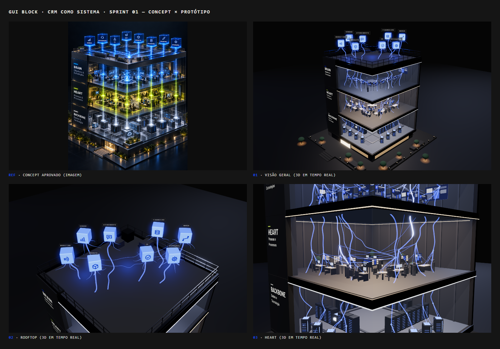

# Sprint 01 — Revisão: concept × protótipo

| Vista | 1440×900 | 1280×800 |
| --- | --- | --- |
| Visão geral | [final-overview](screenshots/final-overview.png) | [final-1280-overview](screenshots/final-1280-overview.png) |
| Rooftop | [final-rooftop](screenshots/final-rooftop.png) | [final-1280-rooftop](screenshots/final-1280-rooftop.png) |
| Heart | [final-heart](screenshots/final-heart.png) | [final-1280-heart](screenshots/final-1280-heart.png) |

Estados e movimento:
- **Seleção** (CS, a área com mais relações): [visão geral](screenshots/final-select-overview.png) · [Heart](screenshots/final-select-heart.png)
- **Impulso** se propagando, 4 quadros a cada 350 ms: [1](screenshots/final-pulse-overview-f1.png) · [2](screenshots/final-pulse-overview-f2.png) · [3](screenshots/final-pulse-overview-f3.png) · [4](screenshots/final-pulse-overview-f4.png)
- **Celular** (fora do escopo, só para provar que não quebra): [390×844](screenshots/mobile-overview.png)
- **Iterações** dos checkpoints: [screenshots/historico/](screenshots/historico/)

Ordem de revisão do briefing (seção 7). ✅ corresponde · ◐ parcial · ✕ ainda não · ⇄ diferença decidida com o autor.

## 1. Silhueta e proporção

- ✅ Vista 3/4 pela quina, prédio em corte com fachadas da frente abertas e paredes de fundo fechadas.
- ✅ Rooftop + 3 pavimentos (não 4 andares operacionais), pódio com entrada e escada, terraço.
- ✅ Bordas de laje grossas e legíveis, com linha de luz separando os andares.
- ✅ Empena sólida à esquerda, no lugar dos rótulos do concept, alargada para receber texto.
- ✅ Prédio como protagonista: nenhuma headline nem painel SaaS na cena.
- ✅ **Proporção:** pé-direito subiu de 4,8 para 5,4, e o prédio ficou mais vertical, como no concept. ◐ A câmera do concept ainda é mais próxima (ele corta parte do térreo); a nossa mostra o prédio inteiro.
- ⇄ **Pilar da quina frontal removido** a pedido do autor (lajes em balanço, visão livre).

## 2. Leitura dos três pavimentos

- ✅ **Brain** frio e estratégico: mesa de estratégia, sala de decisão, painéis e um quadro de indicadores por área. Nenhum número de KPI.
- ✅ **Heart** quente e o mais humano: um posto por área com mobiliário do contexto dela, reunião, lounge, plantas e figuras.
- ✅ **Backbone** técnico: fileiras de racks, terminais por área, bandejas e módulo cloud. Nenhum "servidor central = CRM".
- ◐ **Densidade:** o concept tem muito mais gente, telas e detalhe por andar. O protótipo é baixo-poli, como pedido para a primeira prova, e fica legível sem legendas, mas é menos rico.
- ⇄ **Lime no Heart:** o concept pinta o Heart inteiro de amarelo-limão. Aqui o Lime (`#D4FF42`) é só SIGNAL (seleção e atividade), seguindo a gramática ("Signal precisa ser raro") e o briefing ("evitar uma laje inteira em amarelo forte").
- ✅ **Textos da empena:** título e subtítulo por pavimento, com a barra de INDEX na cor do andar (azul, lime, off-white). Em Barlow; a Agrandir não está disponível.

## 3. Cubos e conexões

- ✅ 8 cubos com identidade única, ícone por área e nome curto (Marketing, Vendas, Produto, Atendimento, CS, Financeiro, Operações, Marca).
- ✅ As conexões saem de cubos concretos e atravessam o prédio até destinos reais de cada área (quadro no Brain, posto no Heart, terminal no Backbone).
- ✅ Impulso de energia que **percorre** as conexões (não pisca tudo de uma vez), em 2 áreas de demonstração, mais a selecionada.
- ✅ Estados: idle (pulsação suave da luz), hover/foco (bordas acesas), seleção persistente com as demais áreas recuando. Teclado e toque cobertos.
- ⇄ **Cubos:** opacos de LED (referência do autor), espalhados no rooftop. O concept os mostra translúcidos e em fileira.
- ⇄ **Conexões:** rede neural orgânica e emaranhada (referência do autor), com 16 relações entre áreas. O concept usa conduítes retos e verticais. Isso substitui o item "cabos não cruzam arbitrariamente": a trama cruza de propósito, mas cada filamento liga duas áreas que trabalham juntas.
- ✅ **Relações e postos revisados com especialista em CRM/RevOps** ([RECOMENDACOES_AREAS.md](RECOMENDACOES_AREAS.md)). São 16 relações sem repetição, e as 3 centrais ficam em destaque: Vendas→CS, CS→Marketing, Atendimento→Produto.
- ◐ **Quadros do Brain** ainda são genéricos (barras abstratas). A recomendação de indicadores por área está pronta, mas não foi aplicada.

## 4. Materiais e luz

- ✅ Graphite, off-white e Electric Blue como base; azul concentrado em cubos e conexões.
- ✅ Luz de maquete: ambiente moderado, key com sombra, fill e rim. Luz própria por pavimento (fria, quente, técnica). Bloom só nos emissivos.
- ✅ Térreo habitado e quente (lobby, árvores, balizadores, escada com LED), sem luzes dinâmicas extras.
- ✅ **Backbone sem centro:** bandejas em malha e cloud do porte de um rack. Nada se lê como "servidor central = CRM".
- ◐ **Vidro e reflexos:** o concept tem vidro mais presente, pisos espelhados e muitos pontos de luz. O protótipo é mais seco, com menos reflexo, e lê melhor o interior, mas fica menos "premium render".
- ◐ **Vegetação:** o concept tem jardins densos no rooftop e no térreo. O protótipo tem poucas árvores estilizadas e nenhum jardim no rooftop (o briefing pede para evitar excesso ali).

## 5. Performance e código

- ✅ 60 FPS (vsync) nas três vistas em 1440×900 e 1280×800. Sem vsync: cerca de 334 / 388 / 195 FPS (GTX 1650, produção).
- ✅ Sem erros de console. Restam 2 avisos de bibliotecas (`THREE.Clock`, `X4122` do D3D).
- ✅ Desmontar e remontar 20×: listeners e canvas estáveis, sem aviso de contexto WebGL (residual de heap de cerca de 0,2 MB por ciclo, ver README).
- ✅ Tudo procedural e reutilizável: kit de materiais compartilhado, mobiliário em receitas instanciadas, cubos e conexões em poucas malhas.
- ✅ Troca das 3 vistas sem recarregar; prédio, cubos e conexões são objetos 3D reais e controláveis individualmente.

## Pronto para o Sprint 02?

Os itens 1 a 4 estão aprovados pelo autor ao longo dos checkpoints. Pontos que valem decidir **antes** do scroll com GSAP:

1. Aplicar os indicadores por área nos quadros do Brain (recomendação pronta) ou deixar para os painéis educativos do Sprint 02.
2. A rota de câmera do Sprint 02 (Rooftop → Brain → Heart → Backbone → síntese) pode reaproveitar `VIEWS` e o estado de seleção já existentes (`produto` aceso em todos os andares).
